## Avian acoustic monitoring in Lithuania
-   Year: 2025 - present
-   Funding: National Geographic, Wildlife Acoustics

I am building Lithuania’s first long-term program that uses autonomous recording units to monitor migratory birds. Working with local partners, we are collecting baseline recordings at two ecologically important sites, Žuvintas Biosphere Reserve and Curonian Spit National Park, to support bird conservation in the country.

::: {layout-ncol=2}
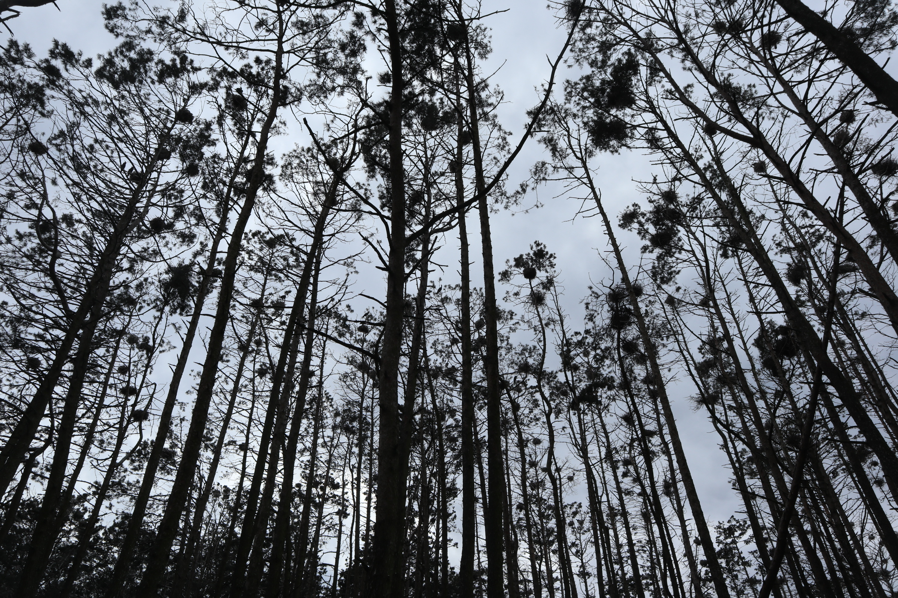

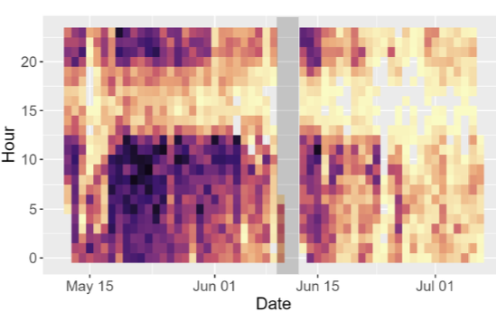
:::

## Turning recordings to ecological inferences
-   Year: 2021 - 2026 (PhD project)
-   Funding: NSERC, Mitacs, SCO-SOC, UNBC

Autonomous recording units can listen to birds on a pre-programmed schedule, but turning large volumes of audio into reliable ecological information is a major challenge. Using three years of recordings from the John Prince Research Forest in British Columbia, I tested how well the AI tool BirdNET identifies birds, and used it to tell individual Barred Owls apart by their calls, track when Olive-sided Flycatchers sing through the season, and link breeding bird diversity to forest structure.

::: {layout-ncol=2}
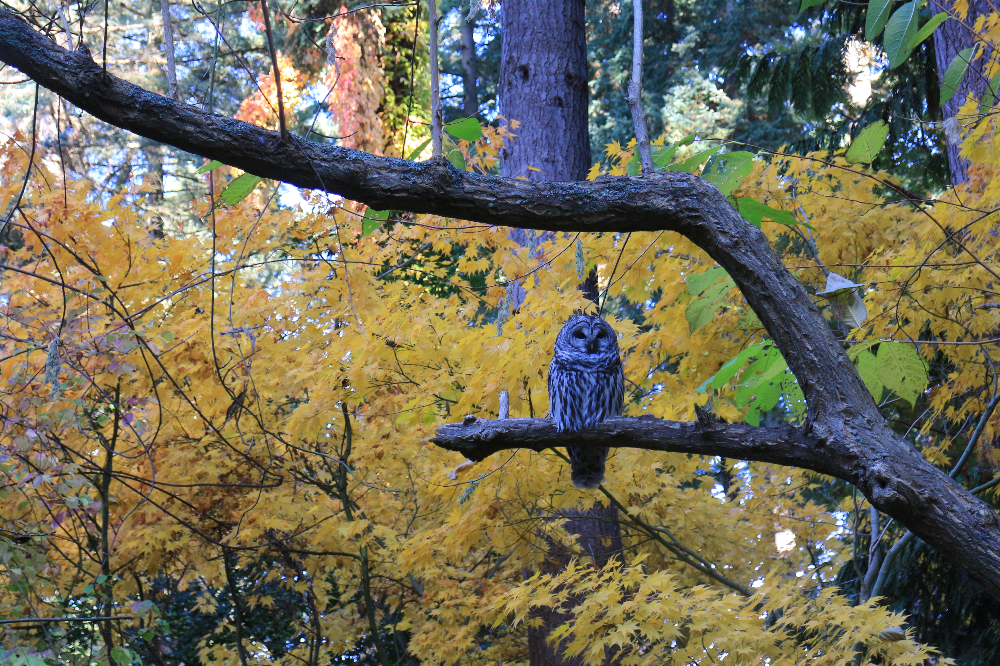

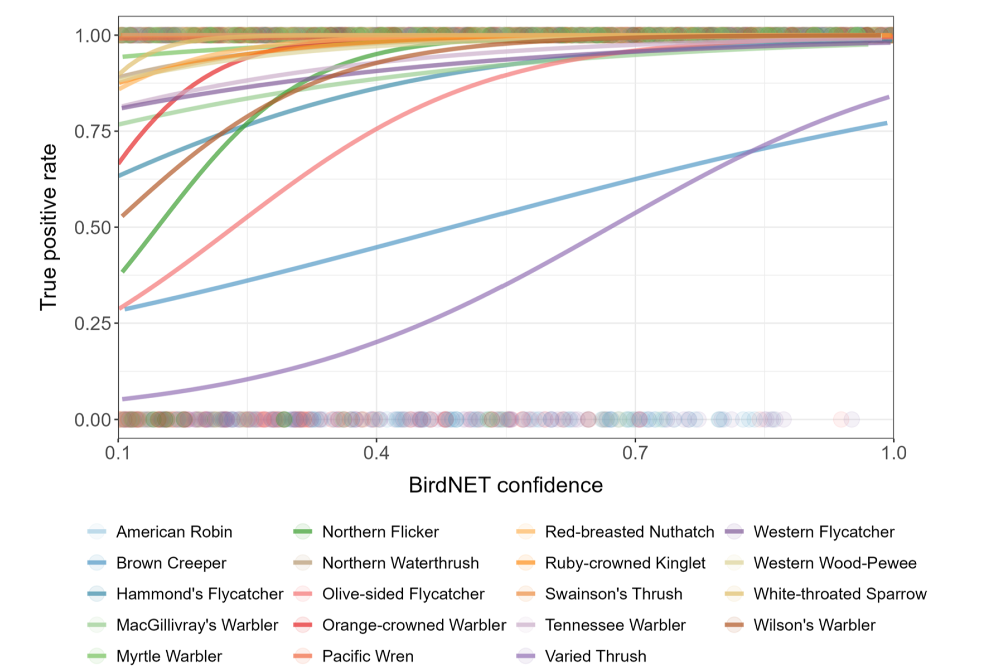
:::

## Avian altitudinal migration
-   Year: 2020 - 2021
-   Funding: Endemic Species Research Institute

Many mountain birds migrate up and down slopes with the seasons, known as altitudinal migration, but this movement is hard to track. We used citizen science observations to map the year-round distribution of the White-eared Sibia across Taiwan, and found that it shifts roughly 300 meters downslope outside the breeding season.

::: {layout-ncol=2}
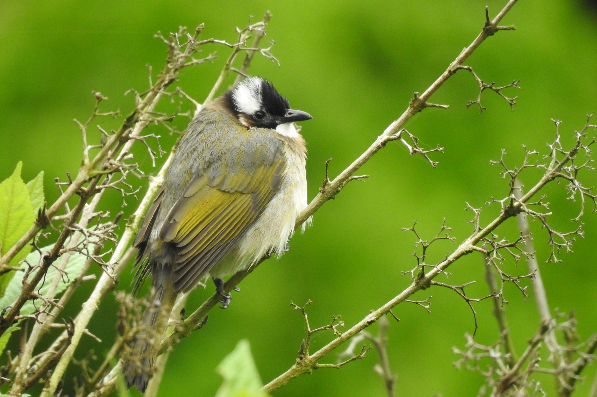

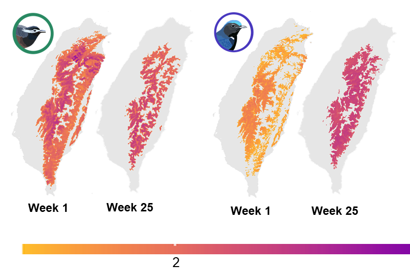
:::

## Previous fire severity enhances reburn severity
-   Year: 2017 - 2019 (MSc project)
-   Funding: NSERC

Wildfires are a natural part of interior British Columbia’s forests, but climate change is making fire seasons longer, warmer, and drier. We studied how the severity of a past fire affects how badly the same area burns the next time, at Riske Creek, to help guide forest management after fires.

::: {layout-ncol=2}
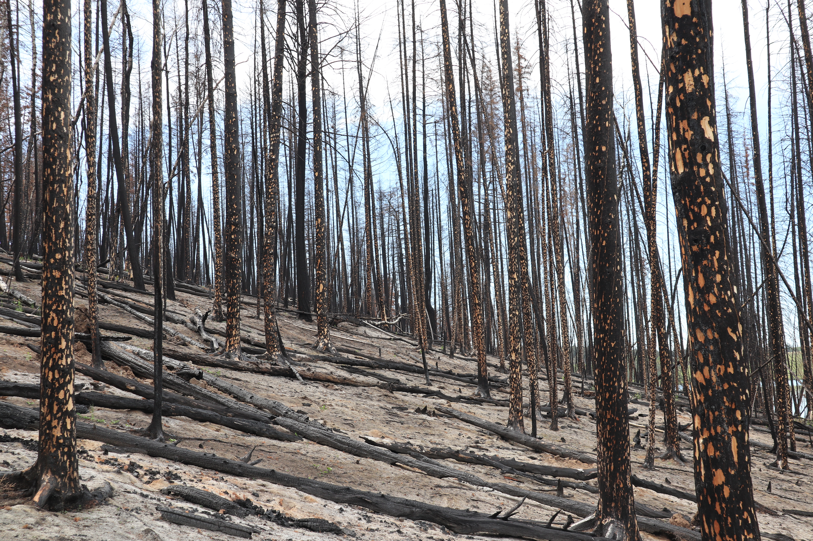

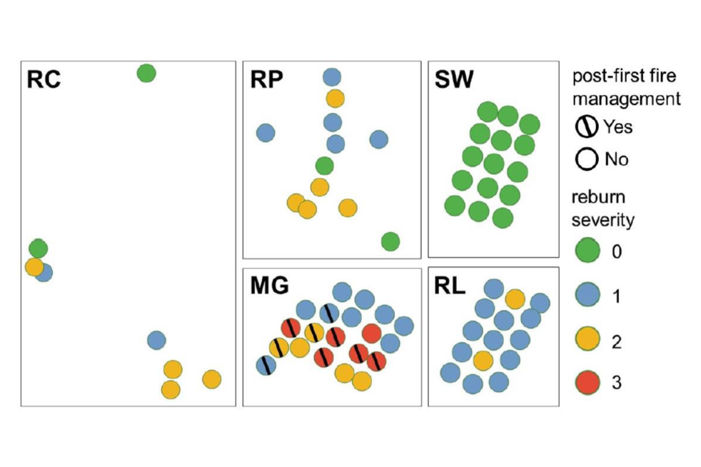
:::

## Automatic bird sound detection
-   Year: 2017 - 2019 (MSc project)
-   Funding: NSERC, Soundscape Association of Taiwan

Autonomous recorders can listen for birds across large areas, but manually checking the recordings becomes infeasible with the large amount of data. We built a statistical model that predicts whether a bird is singing or calling in a recording, even with noise from wind, traffic, insects, or human speech.

::: {layout-ncol=2}
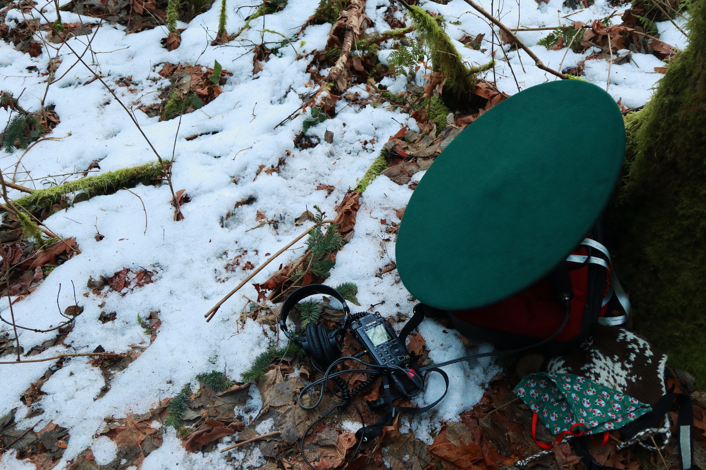

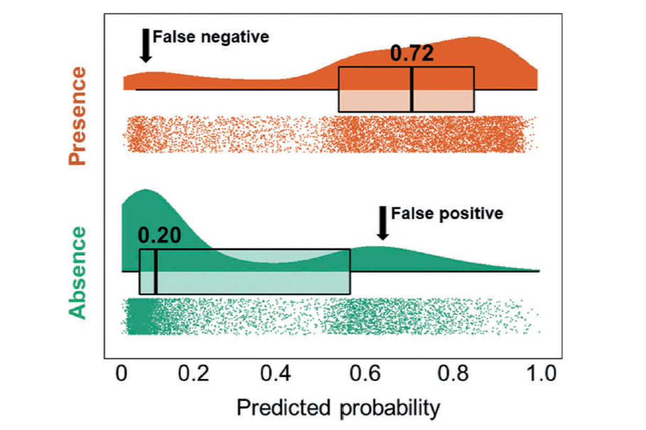
:::

## Acoustic monitoring in Siberian Arctic Tundra
-   Year: 2017
-   Funding: Ecological Engineering Foundation

Siberia’s Indigirka River Delta, one of the most productive tundra areas in the Arctic, hosts 40 to 60 migratory bird species each summer, yet it is so remote and costly to survey that few expeditions have gone there. We used parabolic microphones to record breeding birds in the delta and brought back rare recordings of Arctic bird calls and songs.

::: {layout-ncol=2}
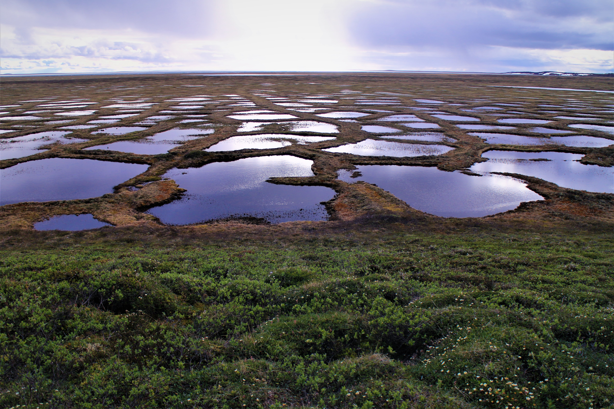

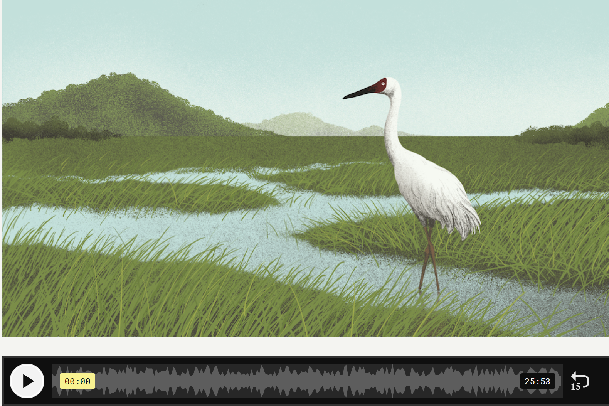
:::

## Chlorophyll fluorescence dynamics
-   Year: 2014 - 2016 (BSc project)
-   Funding: Academia Sinica of Taiwan

Plants give off a faint glow called chlorophyll fluorescence while they photosynthesize, and how this glow changes over time reveals how efficiently they use sunlight. We built a confocal-microscope-based tool that tracks chlorophyll fluorescence in a living plant at the scale of tiny parts inside a single cell, and within thousandths of a second.

::: {layout-ncol=2}
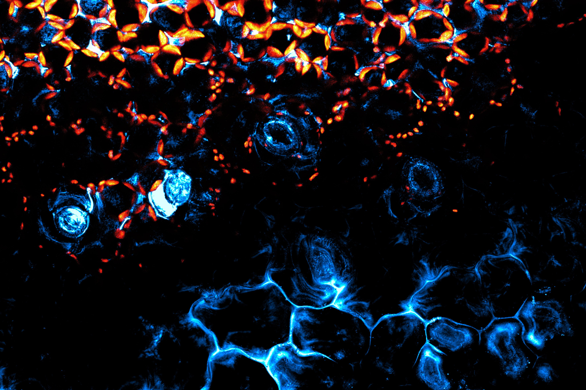

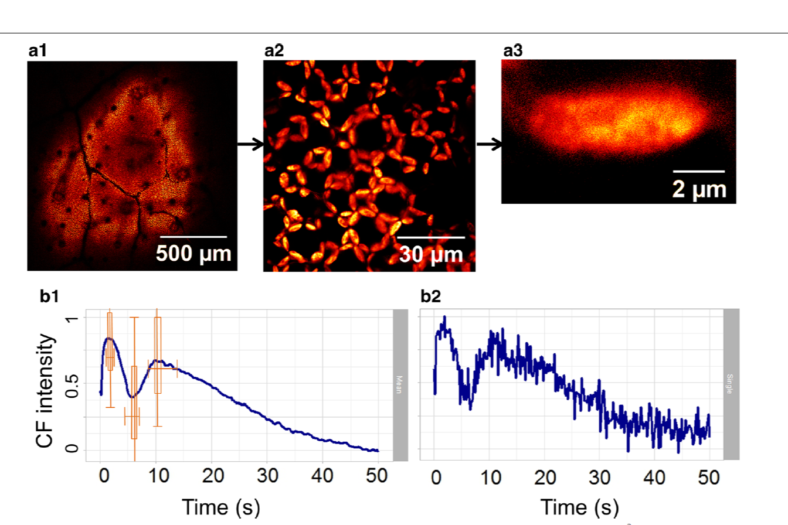
:::

